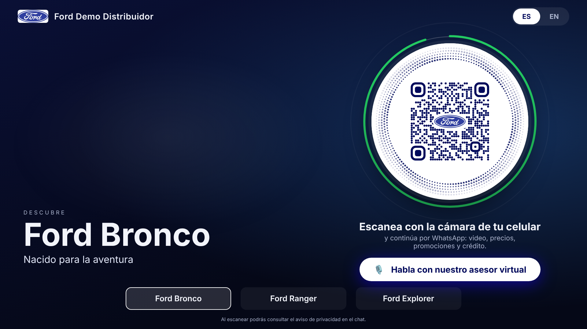

# Ford IM

Kiosco digital con QR dinámico → asesor de WhatsApp con IA (texto y voz) → crédito automotriz
con KYC, formularios precargados, firma DocuSign y envío al banco. Bilingüe (español / inglés),
3 vehículos, CRM self-hosted en `menteia.com`.

> **Demo rápido:** todo en un solo subdominio, `cotizador.menteia.com` (kiosco con QR, CRM de sólo
> lectura, términos, videos y PDFs). Ver **[docs/DEMO.md](docs/DEMO.md)**.



```
ford-im/
├── core/                 Backend Node 22 (un proceso para todos los subdominios) + kiosco + KYC
│   ├── src/routes/       go · kiosk · api (n8n) · kyc · firma · bancos · legal · vendedor (CRM) · admin · demo-home
│   ├── src/services/     qr · sessions · messages · testdrive · credit · forms (PDF) · docusign · mailer · kyc · crm · voice · whatsapp · sheets · flow
│   ├── src/data/forms/   bbva-demo.pdf (formulario con campos para DocuSign)
│   ├── scripts/          write-env · check-env · n8n-import · build-demo-form
│   ├── src/data/         vehicles.json (3 modelos) · dealers.json (dealers y kioscos) · banks.json
│   ├── public/kiosk/     App del panel táctil (QR con ondas + agente de voz ElevenLabs)
│   ├── public/kyc/       KYC con cámara: INE o pasaporte + prueba de vida
│   ├── public/vendedor/  Bandeja del vendedor, funnel y agenda de pruebas de manejo
│   ├── public/media/     Videos y PDFs del demo
│   ├── public/legal/     Avisos de privacidad y términos ES/EN (plantillas)
│   └── test/             Pruebas (node --test): flujo completo QR → dictamen del banco
├── n8n/                  Workflow importable del agente de WhatsApp (+ generador)
├── agent/                Prompt del agente de WhatsApp y configuración del agente de voz
├── docs/                 Arquitectura, CRM, pendientes y recomendaciones
├── docker-compose.yml    core + Caddy (TLS) + Twenty CRM (+ n8n opcional)
├── Caddyfile
└── .env.example
```

## Subdominios

| Subdominio | Qué es |
|---|---|
| `fordim.menteia.com` | App del kiosco (`/k/<ID>?key=<llave>`) |
| `go.menteia.com` | Destino del QR: valida el token de 30 s y abre WhatsApp |
| `api.menteia.com` | API para n8n (`/v1/*`) y métricas (`/admin/metrics`) |
| `kyc.menteia.com` | Verificación de identidad: INE + selfie + CURP |
| `firma.menteia.com` | Liga estable de firma (genera la sesión DocuSign al abrirla) + webhook DocuSign Connect |
| `bancos.menteia.com` | Portal del analista del banco para registrar el dictamen / descargar expediente |
| `legal.menteia.com` | Aviso de privacidad, aviso de crédito y términos (ES/EN) |
| `vendedor.menteia.com` | Bandeja del vendedor (tomar/devolver al bot, responder), funnel y agenda |
| `crm.menteia.com` | Twenty CRM self-hosted |
| `n8n.menteia.com` | n8n (si no lo tienes ya en otro servidor) |

## Arranque local

```bash
cd core
npm install
npm test                       # 14 pruebas: flujo completo, KYC, pruebas de manejo, bandeja, modo demo

# demo local en un solo host (abrir http://cotizador.localhost:3000/)
PUBLIC_SCHEME=http PORT=3000 SINGLE_HOST=cotizador.localhost:3000 DEMO_MODE=true DEMO_SEED=true \
ENABLED_BANKS=bbva KIOSK_KEYS=K-DEMO-01:demo npm start

# o con un subdominio por sitio (*.localhost)
PUBLIC_SCHEME=http PORT=3000 KIOSK_KEYS=K-DEMO-01:demo \
HOST_KIOSK=fordim.localhost:3000 HOST_GO=go.localhost:3000 HOST_API=api.localhost:3000 \
HOST_KYC=kyc.localhost:3000 HOST_FIRMA=firma.localhost:3000 HOST_BANCOS=bancos.localhost:3000 \
HOST_LEGAL=legal.localhost:3000 npm start
# abrir http://fordim.localhost:3000/k/K-DEMO-01?key=demo
```

Sin credenciales, WhatsApp, DocuSign y el correo funcionan en modo de prueba: los mensajes se
imprimen en consola, la firma se simula y el correo se genera sin enviarse.

## Producción

```bash
cp .env.example .env   # completar
docker compose up -d   # o: docker compose --profile n8n up -d
```

Después: importar `n8n/ford-im-whatsapp-agent.json` en n8n, asignar credenciales y apuntar el
webhook de la app de Meta a `https://<tu-n8n>/webhook/ford-im/whatsapp`.

Más detalle en [docs/ARQUITECTURA.md](docs/ARQUITECTURA.md) y lo que falta de tu lado en
[docs/PENDIENTES.md](docs/PENDIENTES.md).
