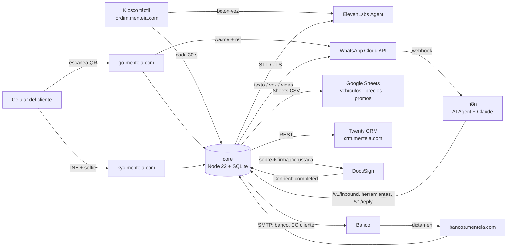
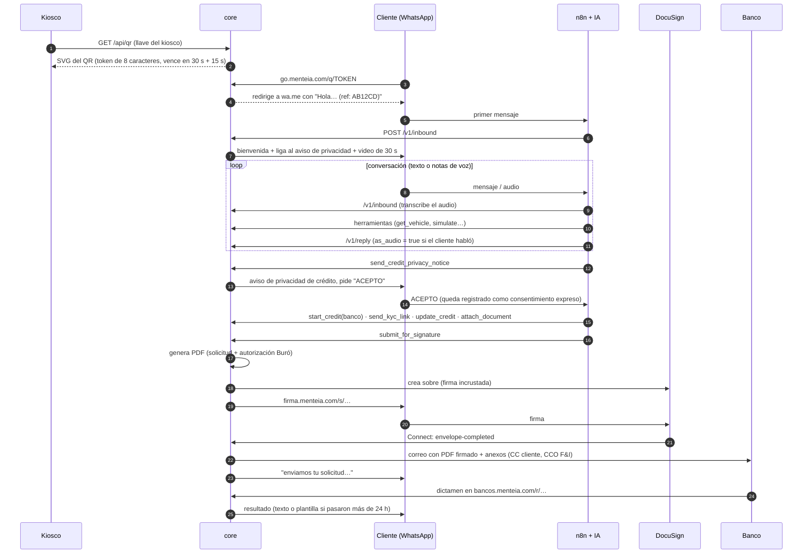

# Arquitectura Ford IM

## Vista general

## Recorrido

## Decisiones clave

**QR con ondas, pero estándar.** Los códigos circulares de Apple (App Clip Codes) son un formato
propietario que la cámara de Android no lee. Por eso el kiosco muestra un QR estándar de nivel H
dibujado con puntos redondos dentro de un círculo, con anillos concéntricos de puntos alrededor,
ondas animadas y el logo al centro. Los patrones de posición y alineación son sólidos para no
perder legibilidad. Validado con un decodificador automático en 72 de 72 combinaciones de URL y
tamaño (180 a 900 px).

**Rotación de 30 s.** Cada QR lleva un token aleatorio de 8 caracteres guardado en la BD con su
vencimiento (30 s + 15 s de gracia). Una foto del QR compartida deja de servir en menos de un
minuto. Además, el `ref` del mensaje de WhatsApp vence en 30 minutos y sólo lo puede reclamar el
primer número que lo usa. Si el kiosco pierde conexión, el QR se difumina: nunca muestra uno
vencido.

**n8n orquesta, core guarda el estado.** n8n recibe el webhook de WhatsApp y ejecuta el agente de
IA. Todo lo que tiene reglas (consentimientos, validación de CURP/RFC, enganche mínimo, PDF,
DocuSign, correo al banco, CRM) vive en `core` con pruebas. El agente sólo llama herramientas, así
no puede saltarse el consentimiento ni enviar una solicitud incompleta.

**Voz.** Si el cliente manda nota de voz, se transcribe con ElevenLabs Scribe y la respuesta se
sintetiza con ElevenLabs TTS y se convierte a OGG/Opus, para que WhatsApp la muestre como nota
de voz. Las ligas se quitan del audio y se mandan aparte como texto.

**Privacidad (LFPDPPP).** Se usan dos avisos. El simplificado va en el primer mensaje, como
consentimiento tácito para datos de contacto. El de crédito exige consentimiento expreso con
"ACEPTO", porque incluye datos financieros, patrimoniales y biométricos. Cada consentimiento se
guarda con su versión, fecha y evidencia. La autorización de consulta a Buró se firma en DocuSign.

**Firma.** La liga que recibe el cliente es estable (`firma.menteia.com/s/<token>`, 7 días). Al
abrirla, se genera en ese momento la vista de firma de DocuSign, que sólo dura unos minutos y por
eso no se manda directo por WhatsApp.

**Envío al banco.** El correo va al banco, con copia al cliente y copia oculta al F&I del dealer,
y lleva un botón para registrar el dictamen. `BANK_DELIVERY_MODE=secure_link` sustituye los
adjuntos de INE y comprobantes por una liga con caducidad (recomendado: el correo no es un canal
seguro para identificaciones).

## Seguridad

- Ligas firmadas con HMAC y de un solo propósito (`kyc`, `sign`, `bank`, `files`).
- Llave por kiosco, API key para n8n y otra para administración. Las comparaciones son de tiempo
  constante.
- Límite de peticiones por IP en el QR, el KYC y el portal de bancos. Los documentos se guardan
  con permisos 0600 y hash SHA-256.
- Webhook de DocuSign Connect verificado con HMAC.
- HSTS, `nosniff` y `no-referrer`. Las páginas con datos tienen `noindex`.

## Datos

SQLite (`/data/ford-im.sqlite`) con estas tablas: `qr_tokens`, `sessions`, `consents`,
`credit_apps`, `documents`, `kyc_checks` y `events` (de aquí sale el funnel de `/admin/metrics`).
Los archivos se guardan en `/data/files/<sesión>/`. Respalda el volumen `core_data` a diario.
