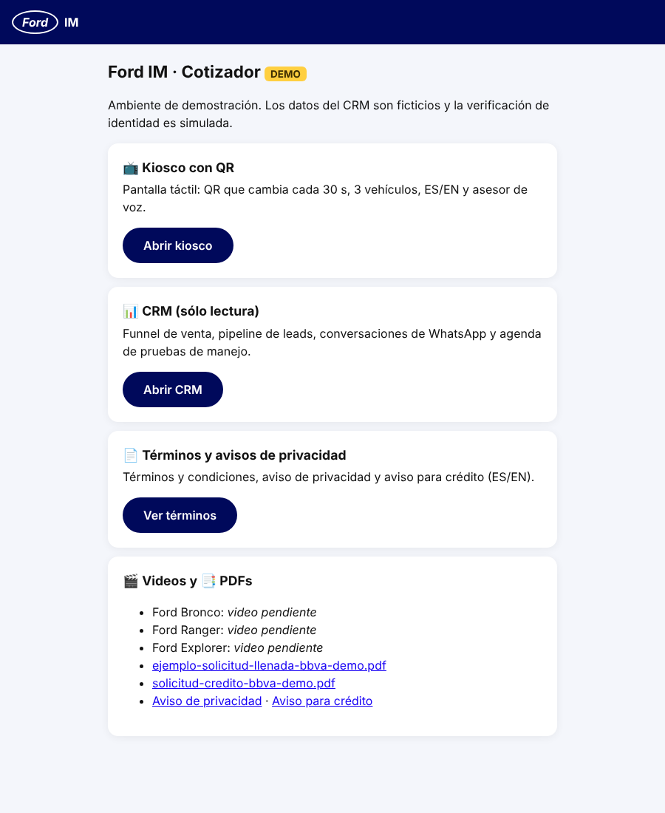
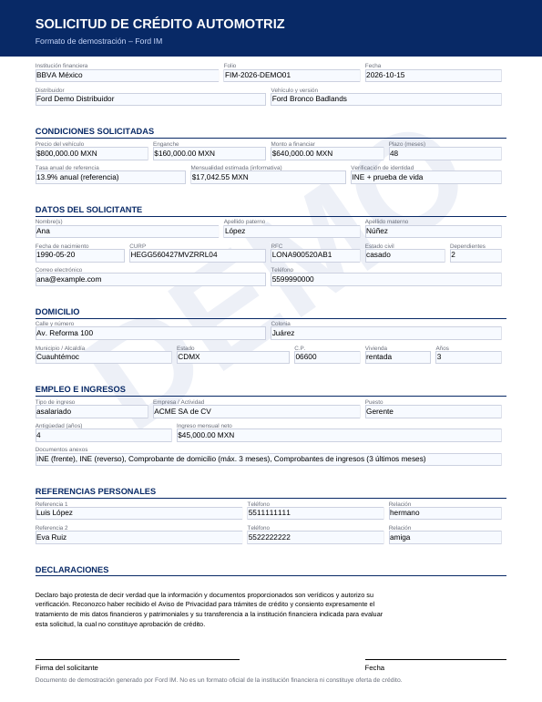
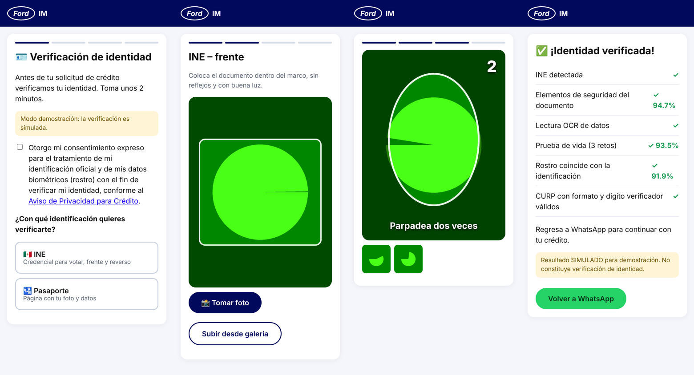
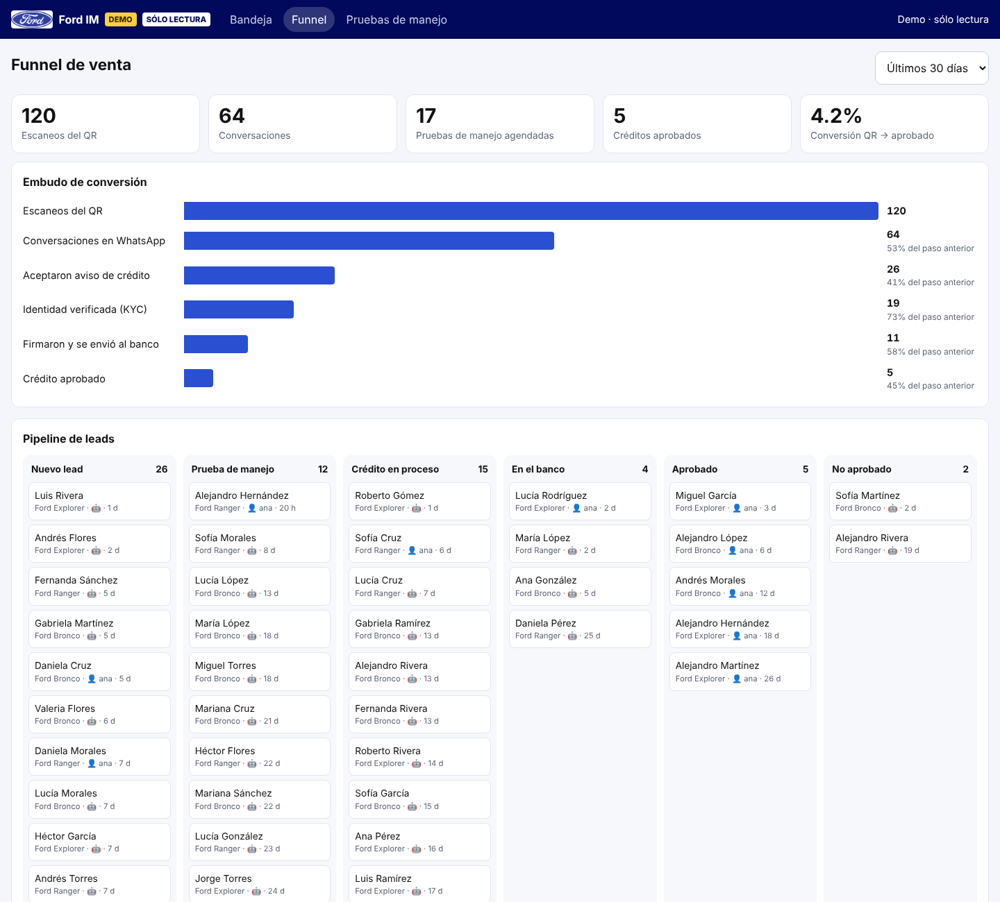

# Demo rápido · `cotizador.menteia.com`

Todo vive en **un solo subdominio**. Es un ambiente **sólo demostrativo**: el CRM es de sólo
lectura con leads ficticios, el KYC es simulado y los correos "al banco" llegan a la dirección de
prueba que tú definas.



| Ruta | Qué muestra |
|---|---|
| `/` | Portada con accesos a todo |
| `/kiosco/k/K-DEMO-01?key=…` | Pantalla táctil: QR de 30 s con logo Ford, 3 vehículos, ES/EN, asesor de voz |
| `/go/q/<token>` | Destino del QR → abre WhatsApp con el código de referencia |
| `/crm/` · `/crm/funnel` · `/crm/agenda` | CRM de sólo lectura: bandeja de conversaciones, funnel de venta, pipeline, pruebas de manejo |
| `/legal/terminos` · `/legal/privacidad` · `/legal/privacidad-credito` | Términos y avisos de privacidad (agrega `?lang=en` para inglés) |
| `/media/videos/…` · `/media/pdf/…` | Videos de 30 s y PDFs (formulario BBVA demo en blanco y ejemplo llenado) |
| `/kyc/k/<token>` | Verificación de identidad: INE o pasaporte + prueba de vida (simulada) |
| `/firma/s/<token>` | Firma DocuSign (sesión incrustada) |
| `/bancos/r/<token>` | Portal donde el "banco" registra el dictamen |
| `/api/v1/…` | API que usa n8n |

## 1. Credenciales: cómo pasármelas

**No las pegues en el chat.** Guárdalas como variables del entorno de la nube de Claude Code (menú
del entorno en la barra de título de la sesión → *Edit* → variables o *Network secrets*). Las
lee una sesión nueva. Después ejecuto:

```bash
cd ford-im/core
node scripts/write-env.mjs   # arma ford-im/.env (no se sube a git) y genera las llaves internas
npm run check:env            # prueba cada servicio sin imprimir valores secretos
```

Variables por servicio (la lista completa está en `core/scripts/env-vars.mjs`):

| Servicio | Variables |
|---|---|
| WhatsApp Cloud API | `WA_DISPLAY_NUMBER`, `WA_PHONE_NUMBER_ID`, `WA_ACCESS_TOKEN` |
| n8n | `N8N_BASE_URL`, `N8N_API_TOKEN` (para importar el workflow con `node scripts/n8n-import.mjs`) |
| DocuSign | `DOCUSIGN_INTEGRATION_KEY`, `DOCUSIGN_USER_ID`, `DOCUSIGN_ACCOUNT_ID`, `DOCUSIGN_PRIVATE_KEY_B64`, `DOCUSIGN_CONNECT_HMAC_KEY` (opcional) |
| ElevenLabs | `ELEVENLABS_API_KEY`, `ELEVENLABS_KIOSK_AGENT_ID`, `ELEVENLABS_VOICE_ES`, `ELEVENLABS_VOICE_EN` |
| Correo | `SMTP_URL`, `BANK_EMAIL_OVERRIDE` (a dónde llega el correo "al banco" en el demo) |
| Google Sheets | `SHEET_VEHICLES_CSV`, `SHEET_PRICES_CSV`, `SHEET_PROMOS_CSV` |
| Servidor | `ACME_EMAIL` y, opcionales, `LEGAL_CONTROLLER_NAME`, `LEGAL_CONTROLLER_ADDRESS` y `LEGAL_PRIVACY_EMAIL` |

`APP_SECRET`, `N8N_API_KEY`, `ADMIN_API_KEY`, `KIOSK_KEYS` y `CRM_VIEW_KEY` se generan solos si no existen. `CRM_VIEW_KEY` protege el CRM: se abre con `/crm/?k=LLAVE`, y la portada ya incluye esa liga.

## 2. DocuSign (cuenta de desarrollador)

1. En [developers.docusign.com](https://developers.docusign.com) entra a tu cuenta *developer*
   (sandbox, servidor `account-d.docusign.com`).
2. *Settings → Apps and Keys → Add App and Integration Key*:
   - Copia el **Integration Key** → `DOCUSIGN_INTEGRATION_KEY`.
   - *Service Integration → Generate RSA*. Guarda la llave privada y conviértela a base64 en una
     línea: `base64 -w0 private.key` (en macOS: `base64 -i private.key`) → `DOCUSIGN_PRIVATE_KEY_B64`.
   - *Redirect URI*: `https://cotizador.menteia.com/firma/gracias`.
3. En la misma página copia **User ID** → `DOCUSIGN_USER_ID` y **API Account ID** → `DOCUSIGN_ACCOUNT_ID`.
4. Otorga el consentimiento una sola vez: `npm run check:env` imprime la liga exacta si falta.
   Ábrela, inicia sesión y acepta.
5. Opcional, para que DocuSign avise al firmar: *Settings → Connect → HMAC* → `DOCUSIGN_CONNECT_HMAC_KEY`.
   Los sobres ya traen su propio webhook a `https://cotizador.menteia.com/firma/webhook`.

El PDF que se firma es `core/src/data/forms/bbva-demo.pdf`. Es un formulario con campos que el
sistema llena con los datos del cliente y luego aplana. Lleva marca de agua **DEMO** y la leyenda
"no es un formato oficial". En la carpeta `/media/pdf/` hay una muestra ya llenada. Cuando BBVA
entregue su PDF oficial con campos, se pone en `src/data/forms/` y se mapean los nombres de campo.



## 3. Despliegue

```bash
# DNS: registro A de cotizador.menteia.com → IP del servidor
cd ford-im/core && node scripts/write-env.mjs && cd ..
docker compose -f docker-compose.demo.yml up -d --build
```

Los videos van en `core/public/media/videos/`. Para cada modelo hay un `<id>-loop.mp4` (loop
horizontal sin audio que se reproduce en la pantalla del kiosco, con su `.webm`) y un
`<id>-30s.mp4` (el que se envía por WhatsApp). Hoy son **videos de muestra** generados por el
sistema. Ver `core/public/media/videos/LEEME.txt`. Las fichas técnicas de referencia
(`/media/pdf/ficha-tecnica-<id>.pdf`) se generan desde `core/src/data/specs.json` con
`npm run build:datasheets`. En n8n, apunta el webhook de la app de Meta a
`https://<tu-n8n>/webhook/ford-im/whatsapp` e importa el workflow
(`node core/scripts/n8n-import.mjs`). Las herramientas ya apuntan a
`https://cotizador.menteia.com/api`.

## 4. Guion sugerido (10 minutos)

1. **Kiosco.** Abre la portada → *Abrir kiosco*. Cambia de modelo y de idioma, y muestra cómo el
   QR se renueva cada 30 s.
2. **WhatsApp.** Escanea con un celular: llegan la bienvenida, el aviso de privacidad y el video.
   Pregunta por versiones con una nota de voz; la respuesta llega en audio.
3. **Prueba de manejo.** "¿Puedo manejarlo el sábado?" → el agente ofrece horarios y agenda. Llega
   la confirmación con la liga para el calendario.
4. **Crédito con BBVA.** "Quiero financiarlo" → aviso de crédito → *ACEPTO* → liga de KYC.
5. **KYC.** Elige INE o pasaporte, toma la foto, haz los 3 retos de prueba de vida y escribe la
   CURP. Resultado: identidad verificada.

   
6. **Datos y firma.** El agente pide plazo, enganche y los datos faltantes. Con todo completo, envía
   la liga de DocuSign: el formulario BBVA demo llega precargado.
7. **Envío al banco.** Al firmar sale el correo a `BANK_EMAIL_OVERRIDE` con copia al cliente. El
   botón *Registrar dictamen* del correo abre `/bancos/r/…`: marca "Aprobado" y el cliente recibe
   la noticia por WhatsApp.
8. **CRM.** `/crm/funnel` muestra el funnel, el pipeline y las pruebas de manejo. `/crm/` muestra
   la conversación completa, con los mensajes del bot y del asesor y el estado de KYC y crédito.



## Qué es simulado

- **KYC:** los puntajes de documento, prueba de vida y coincidencia facial son simulados
  (`KYC_PROVIDER=simulated`). Para producción: Truora, MetaMap o Incode con `KYC_PROVIDER=webhook`.
- **CRM:** los 64 leads de ejemplo son ficticios (`DEMO_SEED=true`). Los leads reales del demo
  aparecen junto a ellos.
- **Banco:** el correo llega a tu dirección de prueba y el dictamen se registra a mano en
  `/bancos`.
- **Videos y fichas técnicas:** los videos son de muestra y las fichas usan datos de referencia
  de fuentes públicas (la mayoría de los campos dice "por confirmar"). El material oficial de Ford
  (videos de prensa, fichas de ford.mx) es para uso editorial; para un uso comercial hay que pedir
  autorización a Ford (media@ford.com) o usar el kit de marketing del distribuidor.
- **Llave del kiosco:** aparece en la portada para facilitar el demo. En producción no.
